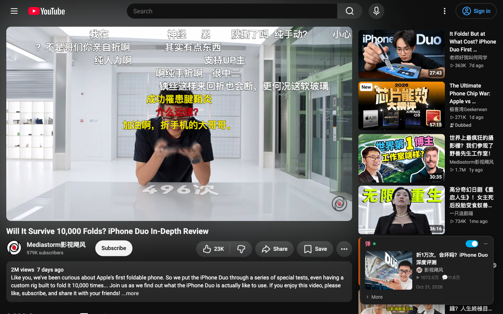
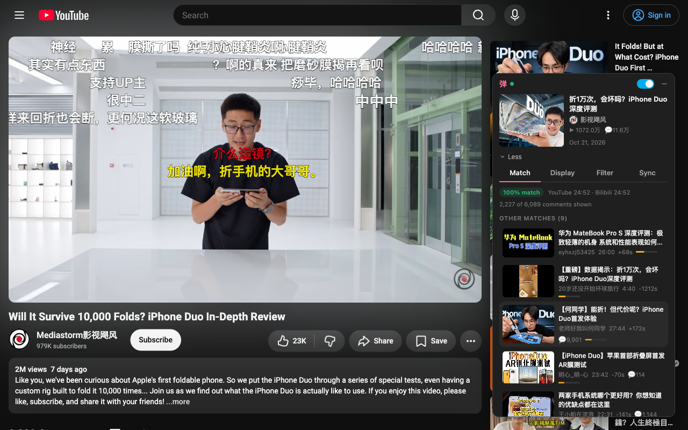
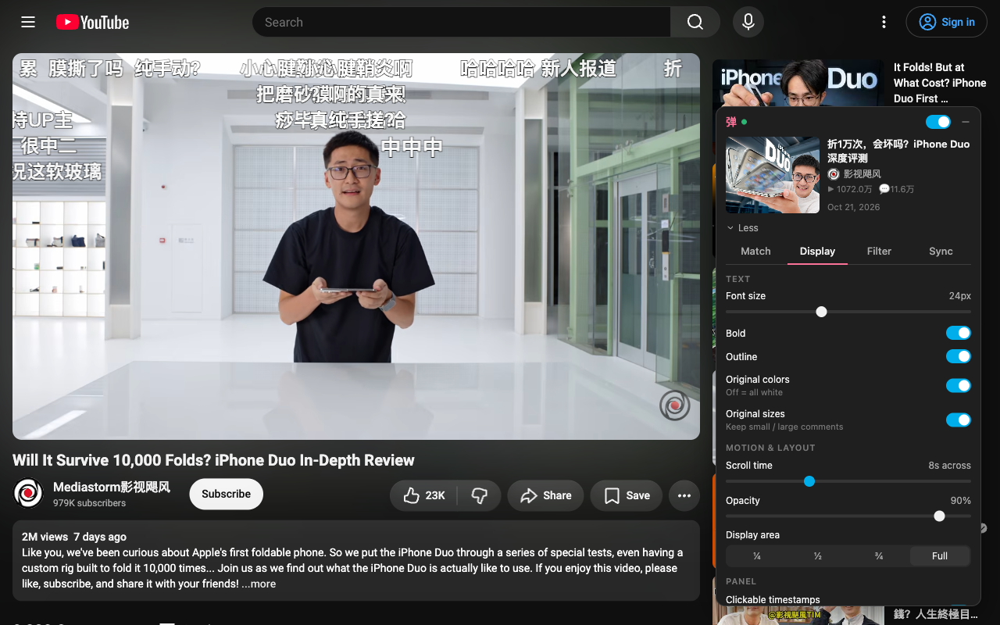
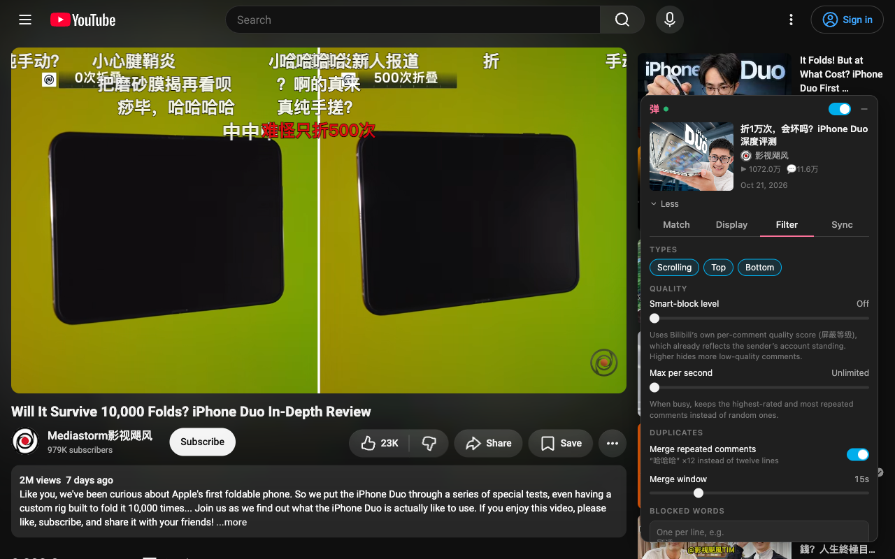

# YouTube→B站弹幕 (YouTube Danmaku Overlay)

Watch YouTube with the Bilibili danmaku. Many creators post the same video on both sites, but the bullet comments only live on Bilibili. This Chrome extension finds the Bilibili upload of the YouTube video you're watching and plays its danmaku over the YouTube player, in sync.

在 YouTube 上看视频，也能看到 B 站的弹幕：自动找到对应的 B 站视频，把弹幕同步叠加到播放器上。



## Features

- **Automatic matching.** Searches Bilibili with several title variants in parallel: the original and translated titles, the Chinese and English halves of bilingual titles, creator + title, and the YouTube id. It also looks through the creator's own Bilibili uploads, which catches retitled copies. Results are ranked by title, length, uploader and upload date, and among equally good copies the one with more danmaku wins. A video is picked automatically only when the match is confident.
- **You stay in control.** "More" lists the other candidates, and you can search Bilibili or paste a BV id or link. Your pick is remembered for that YouTube video.
- **Full danmaku.** Protobuf segments merged with the XML pool, keeping each sender's color, size and position (scrolling, top, bottom).
- **Clickable timestamps.** Times in comments ("空降 5:30", "12:05 高能", "5分30秒") are underlined; click one to jump there.
- **Filters.** Bilibili's smart-block level (屏蔽等级), scrolling/top/bottom toggles, blocked words or `/regex/`, merging of repeated comments ("哈哈哈 ×12"), and a per-second cap that keeps the best comments instead of random ones.
- **Sponsor-aware sync.** If one upload has a sponsor read the other doesn't, the timeline is remapped. Segments come from SponsorBlock / BilibiliSponsorBlock, or are detected from "空降" and "恰饭" comments. A per-video manual offset is saved too.
- **Minimal UI.** A small card in the bottom-right corner shows only the matched video; the Match / Display / Filter / Sync tabs are behind "More". Drag it anywhere; it shrinks to a round button when idle and hides in fullscreen. Danmaku hide during ads and stay clear of YouTube's captions and controls.
- **Fast.** Cached matches skip the search, there are no page-wide DOM observers, and the build is minified.
- **Optional Jev mode** (off by default). TypeSafe's Jev model double-checks the top candidate: it can confirm a match the heuristics weren't sure about, or block one it's confident is wrong. Enable it and paste an API key in the toolbar popup.

| Match details | Display settings | Filters |
|---|---|---|
|  |  |  |

## How It Works

| Step | Where |
|---|---|
| Read video metadata from YouTube's InnerTube API (zh-CN + en titles, real length) | `src/pages/Content/modules/youtube.js` |
| Build search queries and search Bilibili in parallel through the service worker | `modules/queries.js`, `modules/bilibili.js`, `src/pages/Background/modules/bilibiliApi.js` |
| Rank candidates and decide whether to auto-select | `modules/match.js`, `modules/text.js` (`src/shared/jev.js` in Jev mode) |
| Fetch danmaku and sponsor segments, build the time mapping | `bilibiliApi.js`, `sponsorApi.js`, `modules/alignment.js` |
| Filter and render on a canvas inside the player | `modules/danmakuFilter.js`, `modules/renderer.js` |
| Side panel (shadow DOM) | `src/containers/DanmakuPanel/` |

The service worker handles everything Bilibili needs: the `buvid3` cookie, WBI request signing and the Referer header.

## Matching eval

`eval/` holds a held-out benchmark of 173 real YouTube videos from 38 channels, with ground-truth Bilibili counterparts. The labels were built without the matcher and checked by hand. All requests are cached, so the eval replays offline:

```bash
npm run eval                      # top-1 / top-3 / auto-select accuracy, dev and test splits
npm run eval -- --split dev --verbose
npm run eval -- --jev             # compare Jev mode; reads TYPESAFE_API_KEY from a git-ignored .env
```

## Installation

### From Chrome Web Store
1. Visit the Chrome Web Store (link coming soon)
2. Click "Add to Chrome"
3. Follow the installation prompts

### From Source
1. Clone the repository:
   ```bash
   git clone https://github.com/EthanPany/YouTube-Danmaku-Overlay-Chrome-Extension # Replace with your actual repo URL
   cd youtube-danmaku-overlay
   ```

2. Install dependencies:
   ```bash
   npm install
   ```

3. Build the extension (for a quick test or if you don't need watch mode):
   ```bash
   npm run build
   ```
   This creates a production-ready build. For active development, see the "Development" section below.

   watch mode: 
   ```bash
   npm start
   ```

4. Load the extension in Chrome:
   - Open Chrome and navigate to `chrome://extensions/`
   - Enable "Developer mode" in the top right.
   - Click "Load unpacked".
   - Select the `build` directory from the project.

## Usage

1. Open any YouTube video. The panel in the bottom-right corner shows the Bilibili upload it found, and the danmaku start with the video.
2. Use the switch in the panel to turn danmaku off for this video, or the toolbar popup to turn them off everywhere.
3. Wrong video, or nothing found? Click **More** to pick another candidate, search Bilibili, or paste a BV id or link.
4. Display, Filter and Sync settings are also under **More**. Drag the panel by its header to move it; **–** shrinks it to a round button.
5. Log in to bilibili.com in the same browser to get the full comment pool.

## Development

This section explains how to set up and run the extension for active development.

### Setup
First, ensure you've cloned the repository and installed dependencies:
```bash
# Navigate to your project directory if you haven't already
# cd youtube-danmaku-overlay

# Install dependencies
npm install
```

### Running in Development Mode (with Auto-Rebuild)
To develop the extension with real-time automatic rebuilding after you save changes:
```bash
npm start
```
- This command starts webpack in **watch mode** using a development configuration (`webpack.config.js` uses `NODE_ENV` which `npm start` implicitly sets or webpack defaults to 'development' behavior).
- It will automatically recompile the extension whenever you save changes to the source files (e.g., `.js`, `.jsx`, `.css`).
- The development build is output to the `build/` directory. This build is **not minified** and includes settings (like `eval` source maps by default for webpack development mode) for easier debugging in the browser's developer tools.
- After `npm start` has completed its initial build (you'll see output in the terminal), load the extension into Chrome:
    1. Open Chrome and navigate to `chrome://extensions/`.
    2. Ensure "Developer mode" (usually a toggle in the top-right) is **enabled**.
    3. If you had a previous version loaded, remove it first to avoid conflicts.
    4. Click "Load unpacked" and select the `build` directory from your project.
- When you make code changes and save them, webpack will rebuild in the terminal. To see your changes in Chrome:
    - You might need to manually reload the extension from the `chrome://extensions/` page (click the refresh icon on the extension's card or toggle it off and on).
    - Refresh the YouTube tab(s) where you're testing.

### Other Development Scripts
```bash
# Unit tests
npm test

# Lint code
npm run lint

# Format code
npm run format
```

## Build for Production

When you're ready to create a version of the extension for distribution (e.g., to publish on the Chrome Web Store or share with others):

```bash
# Optional: Clean the build directory first to ensure a fresh build
npm run clean

# Build for production
npm run build
```
- This command executes webpack with `NODE_ENV` set to `production` (as defined in your `package.json` script).
- Your `webpack.config.js` uses this to enable production-specific optimizations.
- It generates an optimized and **minified** version of the extension in the `build/` directory. This build is designed to be as small and efficient as possible.

### Packaging for Distribution
After creating a production build, you can package it into a `.zip` file, which is the format required for the Chrome Web Store:
```bash
npm run package
```
- This script first runs `npm run build` to ensure you have the latest production build.
- Then, it navigates into the `build` directory and creates `extension.zip` in the project root, containing all the necessary files for distribution.

## Contributing

1. Fork the repository
2. Create your feature branch (`git checkout -b feature/amazing-feature`)
3. Commit your changes (`git commit -m 'Add some amazing feature'`)
4. Push to the branch (`git push origin feature/amazing-feature`)
5. Open a Pull Request

## License

This project is licensed under the MIT License - see the [LICENSE](LICENSE) file for details.

## Acknowledgments

- [Danmaku](https://github.com/weizhenye/Danmaku) library by weizhenye for the core danmaku rendering engine.
- All the contributors to this project.
- The Bilibili and YouTube communities.

## Support

If you encounter any issues or have questions, please:
1. Check the [FAQ](docs/FAQ.md)
2. Search existing [issues](https://github.com/EthanPany/YouTube-Danmaku-Overlay-Chrome-Extension) 
3. Create a new issue if needed

## Changelog

See [CHANGELOG.md](CHANGELOG.md) for a list of changes.

---

Made with ❤️ for the bilibili and YouTube communities
